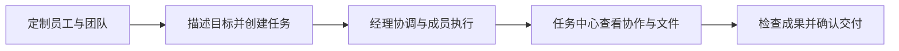

<div align="center">
  
  <h1>AgentForge · AI Team OS</h1>
  <p><strong>面向超级个体的 AI 团队操作系统：像定制虚拟员工一样配置 Agent，组织多 Agent 小组或团队，协作完成任务并交付真实文件。</strong></p>
  <p>你负责目标与决策，让 AI 员工各司其职。</p>
  <p>Claude Code · Codex · DeepSeek Harness</p>
  <p><a href="https://github.com/dengdai68/AgentForge/releases/latest">下载 macOS 版</a> · <a href="#快速上手">快速上手</a> · <a href="#cli让-ai-团队接入你的工具链">CLI</a> · <a href="https://github.com/dengdai68/AgentForge/issues">反馈</a></p>
</div>

从代码开发、调研分析到知识整理和内容生产，你可以为 Agent 定义职责、提示词、模型与工具，与单个虚拟员工交流，也可以组建团队共同执行任务。AgentForge 将成员、协作、执行记录和交付文件组织在同一个本机工作空间中。

## 能做什么

| 能力 | 用法 |
| --- | --- |
| 定制虚拟员工 | 配置职责、系统提示词、Runtime、模型和思考等级；用角色复用提示词、插件与 MCP。 |
| 组织 AI 团队 | 保存常用团队，也可跨团队挑选成员；经理协调分工，不同员工并行执行、独立保留会话。 |
| 任务中心 | 创建、保存草稿或启动任务，搜索与筛选进展，在同一任务里查看协作、控制台和工作目录。 |
| 工作流 | 定义职责节点、交付要求与交接关系，让多 Agent 围绕同一个目标推进工作。 |
| 私聊与群聊 | 与员工讨论需求，通过 @ 定向交流，上传图片和文件，在协作中补充指令或回答澄清。 |
| 定时自动化 | 用 Cron 安排重复任务，独立记录每轮执行、触发状态和成果。 |
| 工具与文件 | 为员工选择插件、Skill 和 MCP；预览、下载实际文件，通过 CHANGE 查看累计修改。 |

## 快速上手



1. **配置成员**：在「数字员工」设置各自的职责与 Runtime。创建任务时，从团队或员工中选择成员，保留一位可用项目经理。
2. **创建任务**：填写目标、背景与可选验收标准，选择工作流或使用默认协作；可以先存草稿，也可以「保存并开始」。
3. **跟进执行**：在任务中心查看派工和交接，回答澄清、追加指令；从「本轮控制台」查看对应执行。发生错误时，修复原因后可继续原员工会话。
4. **检查交付**：直接打开工作目录中的文件与 CHANGE，核对成果后在客户端确认普通任务完成。

<details>
  <summary>查看任务创建界面</summary>
  <p></p>
  <p>v0.1.6-beta.1 隔离实例的真实界面，展示示例任务草稿。</p>
</details>

想直接试一次，可以照着[第一次使用教程](docs/quickstart.md)，让编辑与审校协作整理一份产品发布说明。

## CLI：让 AI 团队接入你的工具链

数字员工、角色、团队、工作流、插件、MCP、Runtime、自动化，以及任务的创建、执行与查询，都可以通过 `agentforge` 操作。CLI 与 App 共用认证和业务规则，支持可读文本、JSON 输出及逐级帮助，适合接入脚本或交给其他 Agent 调用。

| 命令组 | 主要命令 |
| --- | --- |
| `agents` · `roles` · `teams` · `workflows` | `list` / `get` / `create` / `update` / `delete`，管理员工、角色、团队和工作流。 |
| `plugins` | `list` / `get` / `import` / `delete`，以及 `updates` / `check-updates` / `auto-update`。 |
| `mcps` | `list` / `get` / `create` / `update` / `delete`，管理 MCP 服务。 |
| `runtimes` | `list` / `get` / `update` / `test` / `models`，配置和测试模型连接。 |
| `automations` | `list` / `get` / `create` / `update` / `delete` / `trigger` / `triggers`。 |
| `tasks` | `list` / `get` / `create` / `start` / `terminate` / `delete`；用 `progress` / `collaboration` / `artifacts` 查询，用 `members` / `message` / `questions` / `reply` 参与协作。 |
| `auth` | `login` / `status` / `logout`，管理独立 CLI 会话；默认可复用已登录客户端的授权。 |

保持客户端运行并登录，即可在终端使用：

```bash
agentforge help
agentforge agents list --json
agentforge schema tasks
agentforge tasks create --file task.json --start
agentforge tasks progress TASK_ID
agentforge tasks collaboration TASK_ID
```

按 `schema tasks` 的字段与模板编写 `task.json`，成员 ID 可从 `agents list` 或 `teams list` 查询；将 `TASK_ID` 替换为创建返回的任务 ID。任意命令后加 `--help` 查看参数，脚本加 `--json` 获取结构化结果。首次找不到命令时，进入「设置 → 命令行 CLI」修复安装。

普通任务最终验收、私聊群聊、失败后的人工恢复及当前文件浏览仍在客户端完成。完整用法见 [CLI 指南](docs/21-configuration-cli.md)。

## 安装

当前安装包支持 **macOS 13+ / Apple Silicon（M 系列）**。

1. 从 [GitHub Releases](https://github.com/dengdai68/AgentForge/releases/latest) 下载 DMG，将 **AgentForge** 拖入 **Applications**。
2. 当前版本采用 ad-hoc 签名，尚无 Developer ID 签名和 Apple 公证。如果 macOS 提示无法验证或应用已损坏，确认下载来源可信后，在终端执行：

   ```bash
   sudo xattr -dr com.apple.quarantine "/Applications/AgentForge.app"
   ```

   此命令只移除该应用的隔离属性，随后重新打开应用。
3. 首次打开创建本机管理员，在设置中检查 Runtime 和工作目录。提前安装并授权至少一种 **Claude Code、Codex 或 DeepSeek Harness**，即可配置员工并开始使用。

应用自带本机服务，无需部署服务器。软件按 Apache-2.0 开源，模型订阅、API 和第三方工具费用另计。目前为本机单管理员应用，员工以当前系统用户权限执行，不提供 Agent 沙箱；模型调用仍会连接对应服务。尚无 Intel Mac、Windows 或 Linux 安装包。

## 从源码启动

需要 **Node.js 22.12+（推荐 Node 24）**、npm 和 Git：

```bash
git clone https://github.com/dengdai68/AgentForge.git
cd AgentForge
npm ci
npm start
```

`npm start` 启动 Electron 及其自有随机端口后台；`npm run dev` 使用相同入口。源码 CLI 使用 `npm run cli -- help`。更多开发与构建说明见 [CONTRIBUTING](CONTRIBUTING.md)。

---

[使用文档](docs/README.md) · [更新记录](CHANGELOG.md) · [Apache-2.0](LICENSE) · [第三方声明](NOTICE)
