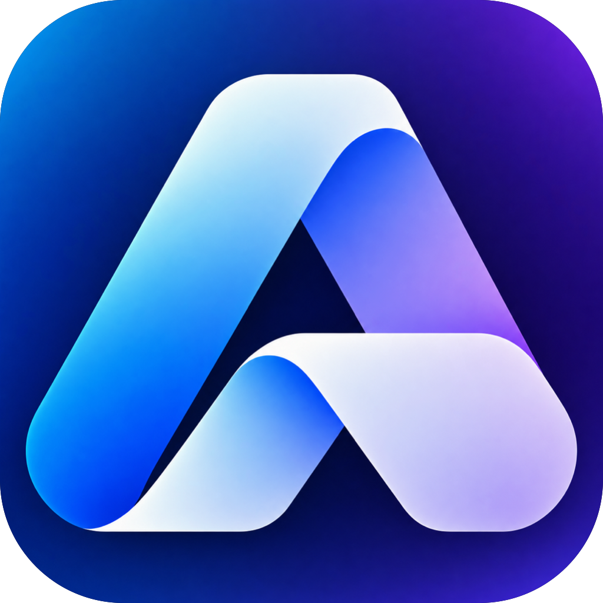
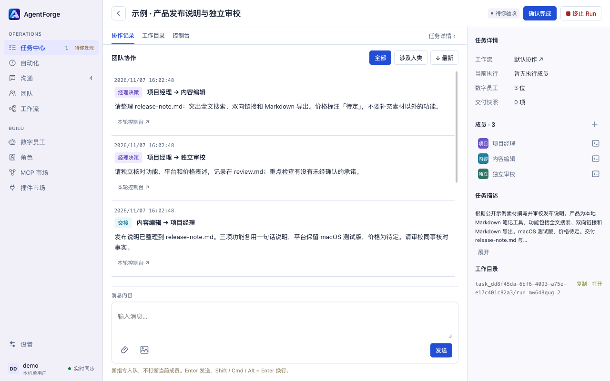
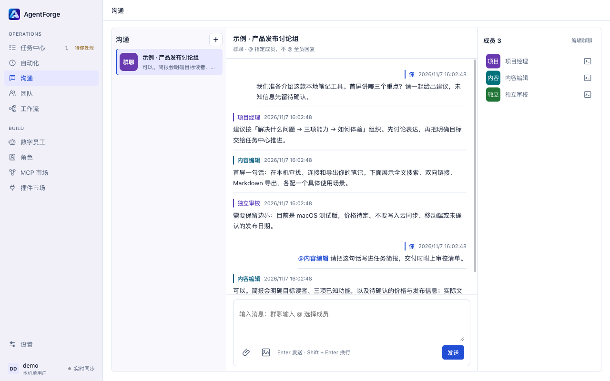
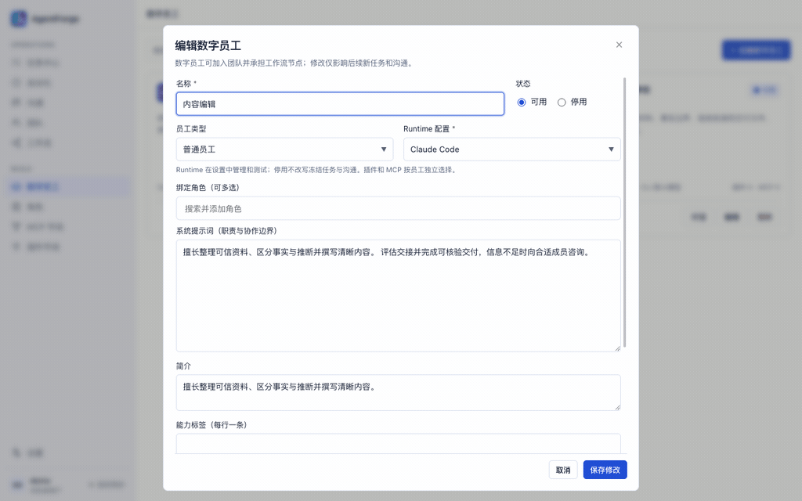

<div align="center">
  
  <h1>AgentForge · AI Team OS</h1>
  <p><strong>面向超级个体的 AI 团队操作系统：像定制虚拟员工一样配置 Agent，组织多 Agent 小组或团队，协作完成任务并交付真实文件。</strong></p>
  <p>你负责目标与决策，让 AI 员工各司其职。</p>
  <p>Claude Code · Codex · DeepSeek Harness</p>
  <p><a href="https://github.com/dengdai68/AgentForge/releases/latest">下载 macOS 版</a> · <a href="#快速上手">快速上手</a> · <a href="#cli让-ai-团队接入你的工具链">CLI</a> · <a href="https://github.com/dengdai68/AgentForge/issues">反馈</a></p>
</div>

从代码开发、调研分析到知识整理和内容生产，你可以为 Agent 定义职责、提示词、模型与工具，与单个虚拟员工交流，也可以组建团队共同执行任务。AgentForge 将成员、协作、执行记录和交付文件组织在同一个本机工作空间中。

| 任务工作空间 | 团队沟通 |
| :---: | :---: |
| 看见经理分工、员工交接与协作记录。 | 多位员工在同一个群聊中讨论，通过 @ 定向提问。 |
|  |  |

*截图使用 v0.1.6 隔离实例中的公开示例数据。*

## 能做什么

| 能力 | 用法 |
| --- | --- |
| 定制虚拟员工 | 配置职责、系统提示词、Runtime、模型和思考等级；用角色复用提示词、插件与 MCP。 |
| 组织 AI 团队 | 保存常用团队，也可跨团队挑选成员；经理协调分工，不同员工并行执行、独立保留会话。 |
| 任务中心 | 创建、保存草稿或启动任务，搜索与筛选进展，在同一任务里查看协作、控制台和工作目录。 |
| 工作流 | 定义职责节点、交付要求与交接关系，让多 Agent 围绕同一个目标推进工作。 |
| 私聊与群聊 | 与员工讨论需求，通过 @ 定向交流，上传图片和文件，在协作中补充指令或回答澄清。 |
| 定时自动化 | 用 Cron 安排重复任务，独立记录每轮执行、触发状态和成果。 |
| 工具与文件 | 为员工选择插件与 MCP，通过插件加载 Skill；预览、下载实际文件，通过 CHANGE 查看累计修改。 |

## 快速上手

**定制员工 → 创建任务 → 在协作记录跟进分工与交接 → 检查文件并确认交付。**



*v0.1.6 界面导览，约 19 秒；协作记录使用示例数据，未调用模型。*

创建任务时选择一位项目经理和执行成员，可先保存草稿或直接「保存并开始」。从任务中心进入工作空间，打开「协作记录」，按时间查看谁把什么工作交给了谁、员工怎样反馈与交接；需要细查时，从消息进入「本轮控制台」。你也可以在这里回答澄清、@ 成员或补充指令，再到「工作目录」检查实际文件，确认普通任务完成。可复制的任务素材见[第一次使用教程](docs/quickstart.md)。

## CLI：让 AI 团队接入你的工具链

通过 `agentforge` 管理配置、创建任务和查询执行。支持逐级 `--help` 和 `--json`，可在终端使用，也可接入脚本或供其他 Agent 调用。

```console
$ agentforge --help
AgentForge 是一个 AI 团队操作系统：让负责人组织具备不同能力的数字员工，协作完成代码开发、企业知识整理、调研和内容生产，并拿到可核验的交付物，而不只是聊天回复。

命令目录
  tasks      任务 / 进度 / 协作 / 澄清
  automations 自动化 / 定时执行 / 触发记录
  agents     数字员工
  roles      角色（共用系统提示词）
  mcps       MCP 市场
  plugins    插件市场
  workflows  工作流
  teams      团队
  runtimes   Runtime 配置与连接查询
  auth       登录 / 会话状态 / 退出登录

查看具体操作参数：在命令后加 --help，例如 agentforge agents get --help。
```

先启动并登录客户端；找不到命令时，在「设置 → 命令行 CLI」修复安装。用 `agentforge tasks create --help` 查看操作参数，`agentforge schema tasks` 查看字段与 JSON 模板。最终验收、私聊群聊、失败后的人工恢复及当前文件浏览仍在客户端完成；详见 [CLI 指南](docs/21-configuration-cli.md)。

## 安装

当前安装包支持 **macOS 13+ / Apple Silicon（M 系列）**。

1. 从 [GitHub Releases](https://github.com/dengdai68/AgentForge/releases/latest) 下载 DMG，将 **AgentForge** 拖入 **Applications**。
2. 当前版本采用 ad-hoc 签名，尚无 Developer ID 签名和 Apple 公证。如果 macOS 提示无法验证或应用已损坏，确认下载来源可信后，在终端执行：

   ```bash
   sudo xattr -dr com.apple.quarantine "/Applications/AgentForge.app"
   ```

   此命令只移除该应用的隔离属性，随后重新打开应用。
3. 首次打开创建本机管理员，在设置中检查 Runtime 和工作目录。提前安装并授权至少一种 **Claude Code、Codex 或 DeepSeek Harness**，即可配置员工并开始使用。

应用自带本机服务，无需部署服务器。软件按 Apache-2.0 开源，模型订阅、API 和第三方工具费用另计。目前为本机单管理员应用，员工以当前系统用户权限执行，不提供 Agent 沙箱；模型调用仍会连接对应服务。尚无 Intel Mac、Windows 或 Linux 安装包。

## 从源码启动

需要 **Node.js 22.12+（推荐 Node 24）**、npm 和 Git：

```bash
git clone https://github.com/dengdai68/AgentForge.git
cd AgentForge
npm ci
npm start
```

`npm start` 启动 Electron 及其自有随机端口后台；`npm run dev` 使用相同入口。源码 CLI 使用 `npm run cli -- help`。更多开发与构建说明见 [CONTRIBUTING](CONTRIBUTING.md)。

---

[使用文档](docs/README.md) · [更新记录](CHANGELOG.md) · [Apache-2.0](LICENSE) · [第三方声明](NOTICE)
